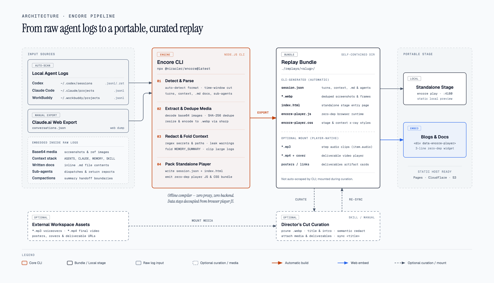

<p align="center">
  
</p>

<p align="center">
  <a href="https://encore.niracler.com/?lang=en"><strong>Live Demos (encore.niracler.com)</strong></a> ·
  <a href="https://www.npmjs.com/package/@niracler/encore"><strong>npm</strong></a> ·
  <a href="./README.md"><strong>English</strong></a> ·
  <a href="./README.zh-CN.md">简体中文</a>
</p>

<p align="center">
  <a href="https://www.npmjs.com/package/@niracler/encore"></a>
  <a href="https://github.com/niracler/encore/actions/workflows/ci.yml"></a>
  = 20.10">
  <a href="./LICENSE"></a>
</p>

**Encore** is like [`asciinema`](https://asciinema.org) for AI Agent sessions. Locally, it turns a raw log from **Codex**, **Claude Code**, **Claude.ai**, or **WorkBuddy** into a portable web replay. Readers can step through turns, tool calls, sub-agents, frames, and deliverables while watching the context snapshot grow and compact in real time.


---

## Quick Start

Requires **Node.js >= 20.10**. No global install needed.

```bash
npx @niracler/encore@latest
```

The interactive picker scans recent local **Codex**, **Claude Code**, and **WorkBuddy** sessions and opens the selected replay in your browser. You can also pass a `.jsonl` or `.jsonl.zst` raw log, or a Claude.ai `conversations.json` export directly.

Without `-o`, replays write to a temporary directory. Pass `-o <dir>` to keep a portable copy for publishing; see `npx @niracler/encore@latest --help` for all commands and options.

---

## How It Works

<p align="center">
  <picture>
    <source media="(prefers-color-scheme: dark)" srcset="./docs/architecture-en-dark.webp">
    <source media="(prefers-color-scheme: light)" srcset="./docs/architecture-en-light.webp">
    
  </picture>
</p>

- **Local-only processing**: Adapters, `.webp` frame extraction, automatic redaction, and leak checks all run locally in Node.js. Nothing is uploaded.
- **Decoupled Session and Player**: `session.json`, extracted `.webp` frames, and collected files live beside the zero-dependency player, so edits to `session.json` appear on browser reload.
- **Explicit file collection boundaries**: Encore collects locally referenced attachments and deliverables within allowed asset roots (defaulting to the current directory and native session workspace; override with `--asset-root`), builds in-place PDF and workbook previews, and labels each file as verified (matching SHA-256), an export-time copy, or missing.

---

## Curating Before Publishing (Optional)

For personal review or internal archiving, the CLI export is ready to watch as-is—no skill needed. When preparing a replay for a blog, course, or public showcase, pair the export with the companion `encore` skill for a semantic curation pass.

**What the CLI handles automatically**

- Adapts the raw log, extracts deduplicated `.webp` frames, collects referenced attachments and deliverables from asset roots, and builds in-place previews
- Redacts common API keys, private keys, JWTs, database URLs, emails, private IPs, and home paths, omits cross-session `MEMORY_SUMMARY` and user-level `CLAUDE.md` bodies by default, and runs a non-blocking leak check
- Packages a standalone replay directory with the zero-dependency player

**What the `encore` skill adds during curation**

- **Curate & label frames**: Inspects `.webp` frames, drops noisy intermediate states, keeps key milestones, and replaces fallback labels with concrete descriptions
- **Write intro & trim turns**: Drafts a concise `title` and opening `description` from full context, and trims off-topic opening or closing turns
- **Manual redaction & file review**: Reviews leak check warnings, removes internal codenames, people's names, and business figures regex cannot detect, and audits raw files in `attachments/`
- **Lossless rebuild**: Runs `npx @niracler/encore@latest <replay-dir>` to refresh player assets and previews, sync `<title>`, drop deleted frame references, and re-run the leak check without overwriting curation edits or added media

Install the skill globally (or copy [`skills/encore/SKILL.md`](./skills/encore/SKILL.md) manually):

```bash
npx skills add niracler/encore -g
```

Then ask your Agent from any workspace:

```text
Use the encore skill to export my latest session and curate it for publishing.
```

> **Review before sharing**: Automatic redaction only rewrites `session.json`; it never modifies copied PDFs, workbooks, images, or videos in `attachments/`. Review `session.json`, every kept `.webp` frame, and all packaged attachments and deliverables before publishing.

---

## Embedding on Any Site

Export with `-o ./replays/<slug>` and deploy the entire replay directory to GitHub Pages, Cloudflare Pages, Vercel, or any static host—or embed the player in an existing HTML page with three lines:

```html
<link rel="stylesheet" href="./encore-player.css">
<div data-encore-player src="./session.json" data-lang="en"></div>
<script src="./encore-player.js" defer></script>
```

Omit `data-lang` to follow the language set in `session.json`. The player also natively renders optional curated extensions in `session.json`, including per-step audio (`item.audio`), landscape/portrait video switching, and PDF/workbook revision diffs.

<details>
<summary><strong><code>session.json</code> Schema</strong></summary>

Formal JSON Schema: [`schema/session.schema.json`](./schema/session.schema.json) (`https://encore.niracler.com/schema/session.schema.json`) · TypeScript Definitions: [`src/index.d.ts`](./src/index.d.ts)

```json
{
  "$schema": "https://encore.niracler.com/schema/session.schema.json",
  "tool": "codex",
  "model": "gpt-5.4",
  "title": "Redesigning the 7-Stage Architecture Diagram",
  "description": "Started with a cluttered layout, pivoted to a two-column grid after visual review, and exported the final SVG.",
  "lang": "en",
  "contextWindow": 258400,
  "deliverables": [{ "title": "Final Diagram", "href": "./final-diagram.webp", "meta": "SVG / WebP · 1920×1080" }],
  "frames": [{ "time": "2026-11-17T10:04:12.000Z", "img": "a1b2c3d4e5f6.webp", "who": "ai", "label": "Draft 1", "w": 960, "h": 540 }],
  "items": [
    { "type": "user", "text": "...", "time": "..." },
    { "type": "tool", "name": "exec_command", "summary": "...", "stats": { "command": 1 }, "time": "..." },
    { "type": "compact", "seq": 1, "trigger": "auto", "preTokens": 210000, "postTokens": 42000, "time": "..." },
    { "type": "assistant", "text": "...", "time": "..." }
  ]
}
```

</details>

---

## FAQ

### Does Encore upload my logs? How does redaction work?

**No—everything runs locally.**

- **Automatic redaction**: Hides common API keys, private keys, JWTs, database URLs, emails, private IPs, and home directory paths (replaced with `~`), omits cross-session `MEMORY_SUMMARY` and user-level `CLAUDE.md` bodies by default, and runs a non-blocking leak check.
- **Manual review still needed**: Project codenames, business figures, and raw files copied into `attachments/` (PDFs, workbooks, images, videos) are never rewritten automatically.

### Why doesn't double-clicking `index.html` work?

Browser security rules block `fetch('./session.json')` on `file://` URLs. Open the replay through the local preview server, or deploy the folder to any static host:

```bash
npx @niracler/encore@latest play ./replays/<slug>
```

### Will deleting the raw log or source files break a replay?

**No.** A replay directory is a self-contained static bundle (`session.json`, `.webp` frames, `attachments/`, and player assets). Keep the directory intact; only external URLs still depend on their hosts.

### Why is an attachment labeled as an export-time copy or missing?

- **Verified**: Found inside an allowed asset root with a SHA-256 matching the digest recorded in the session.
- **Export-time copy**: Found at export time, but no matching session digest exists or the file changed afterward.
- **Missing / Outside asset roots**: Referenced in the log, but absent on disk or outside the allowed asset roots (pass `--asset-root` to include another directory; the filename stays visible under the message).

### Are token counts in the Context Snapshot exact billing figures?

**No.** They visualize context structure and growth: when a raw log includes real token counts (including `preTokens` / `postTokens` around compactions), Encore displays them directly; when per-step totals or category breakdowns are missing, it estimates from content length.

---

## Contributing & License

Architecture notes and development commands live in [`AGENTS.md`](./AGENTS.md), and shared domain terminology lives in [`GLOSSARY.md`](./GLOSSARY.md). Run `pnpm test` before opening a pull request to verify adapters, redaction rules, and player build sync. To request support for another Agent format, open an issue.

[MIT](./LICENSE)
