<p align="center">
  
</p>

<p align="center">
  <a href="https://encore.niracler.com/?lang=en"><strong>Live Demos (encore.niracler.com) ↗</strong></a> ·
  <a href="https://www.npmjs.com/package/@niracler/encore"><strong>npm ↗</strong></a> ·
  <a href="./README.md"><strong>English</strong></a> ·
  <a href="./README.zh-CN.md">简体中文</a>
</p>

<p align="center">
  <a href="https://www.npmjs.com/package/@niracler/encore"></a>
  <a href="https://github.com/niracler/encore/actions/workflows/ci.yml"></a>
  = 20.10">
  <a href="./LICENSE"></a>
</p>

**Encore** is like [`asciinema`](https://asciinema.org) for AI agent sessions. It turns raw transcripts from **Codex**, **Claude Code**, **Claude.ai**, and **WorkBuddy** into a self-contained web replay, entirely on your machine. Readers can step through prompts, tool calls, sub-agent work, and screenshots while watching the context window grow and compact in real time.


---

## Live Demos

The [showcase](https://encore.niracler.com/?lang=en) opens on four featured replays: two following the making of *70 Years of AI* (starting on the first cut), and two comparing how Codex and WorkBuddy handled the same buyer-research brief. The interface and case notes switch between English and Chinese, while transcripts stay in their original language.

| Demo | Agent | Highlights |
| :--- | :--- | :--- |
| [70 Years of AI · First cut](https://encore.niracler.com/?lang=en) | **Claude.ai** | Dispatches 7 sub-agents to fact-check history and script a 4-minute, 10-second preview |
| [70 Years of AI · Final cut](https://encore.niracler.com/?demo=ai-tree-1015&lang=en) | **Claude.ai** | Incorporates viewer feedback on photos and glossary into landscape and portrait cuts |
| [Overseas lighting buyers](https://encore.niracler.com/?demo=lesson-00-buyers-codex&lang=en) | **Codex** | Sends 3 sub-agents across Germany, the UK, and Australia to compile 26 prospective buyers |
| [Overseas lighting buyers](https://encore.niracler.com/?demo=lesson-00-buyers-workbuddy&lang=en) | **WorkBuddy** | Reassigns 3 quota-limited tasks to deliver a 32-company shortlist |

Additional replays are available by direct link:

| Demo | Agent | Highlights |
| :--- | :--- | :--- |
| [Poster redesign](https://encore.niracler.com/?demo=poster-redesign&lang=en) | **Codex** | Iterates on a course poster across 7 `.webp` frames, including an automatic context compaction |
| [Site integration](https://encore.niracler.com/?demo=work-stages-site&lang=en) | **Claude Code** | Coordinates 4 sub-agents across 5 frames and fixes a page rendering its script as plain text |
| [7-stage diagram redesign](https://encore.niracler.com/?demo=work-stages-design&lang=en) | **Claude.ai** | Explores 6 layout directions across 9 drafts from a `conversations.json` web export |
| [Open-source research: x-cmd](https://encore.niracler.com/?demo=xcmd-research&lang=en) | **WorkBuddy** | Runs 4 parallel sub-agents to research a public project from scratch |

---

## Quick Start

Requires **Node.js >= 20.10**. No global install needed:

```bash
# Interactive picker — scans ~/.codex/sessions, ~/.claude/projects, and ~/.workbuddy/projects
# Use ↑ / ↓ to select and ← / → to flip pages
npx @niracler/encore@latest

# Export a specific log — auto-detects .jsonl, .jsonl.zst, and Claude.ai conversations.json
npx @niracler/encore@latest /path/to/rollout.jsonl -o ./replays/my-session

# Preview an existing replay locally (default: http://localhost:4180)
npx @niracler/encore@latest play ./replays/my-session
```

Without `-o`, Encore writes a self-contained folder at `./replays/<session-slug>/` containing `session.json`, deduplicated `*.webp` frames, `index.html`, `encore-player.js`, and `encore-player.css`.

---

## How It Works

<p align="center">
  <picture>
    <source media="(prefers-color-scheme: dark)" srcset="./docs/architecture-en-dark.webp">
    <source media="(prefers-color-scheme: light)" srcset="./docs/architecture-en-light.webp">
    
  </picture>
</p>

- **Local-only processing**: Parsing, WebP conversion, and baseline redaction all run locally in Node.js. Nothing is uploaded.
- **Decoupled data and player**: `session.json` and extracted `.webp` frames live next to the zero-dependency player bundle, so edits to text or frames take effect on reload with no rebuild.
- **Explicit media boundary**: Encore automatically extracts only Base64 images and inline `.md` writes embedded in the transcript. External workspace files (`.mp3`, `.mp4`, posters, PDFs) are never scraped automatically—copy in and link only what you intend to publish.

---

## Polishing Before Publishing (Optional)

Raw exports often include noisy intermediate screenshots, an opening prompt used as the title, and internal names that regex cannot catch. Copy [`skills/encore/SKILL.md`](./skills/encore/SKILL.md) into `.agents/skills/encore` (or `~/.codex/skills/encore` / `~/.claude/skills/encore`), then ask your agent to prune and label frames, write a clear title and intro, scrub project-specific details, and trim off-topic turns:

```text
Use the encore skill to export my latest session and polish session.json for publishing.
```

After editing `session.json` by hand, re-run `npx @niracler/encore@latest ./replays/my-session` to sync `<title>`, drop references to deleted frames, and re-run leak checks. Re-running on an existing replay folder preserves your manual edits and any media files you added.

---

## Embedding on Any Site

Deploy the generated folder to GitHub Pages, Cloudflare Pages, Vercel, or any static host—or embed the player in an existing HTML page with three lines:

```html
<link rel="stylesheet" href="./encore-player.css">
<div data-encore-player src="./session.json" data-lang="en"></div>
<script src="./encore-player.js" defer></script>
```

Omit `data-lang` to follow the language set in `session.json`.

<details>
<summary><strong>CLI Reference &amp; <code>session.json</code> Schema</strong></summary>

### CLI Options

```text
Usage:
  encore                              Scan recent Codex, Claude Code & WorkBuddy sessions and pick one interactively
  encore <log.jsonl | dir> [options]  Build a standalone replay directory from a log or re-render an edited session.json
  encore play <dir> [--port 4180]     Start local preview server for an existing replay directory

Options:
  -o, --out <dir>          Output directory (default: ./replays/<session-slug>)
  -l, --lang <zh|en|auto>  Player UI language (default: auto; also toggleable in the topbar)
      --title <text>       Override session title
      --desc <text>        Set opening description shown before playback starts
      --from <iso-time>    Start time window filter (e.g. 2026-11-10T09:00)
      --to <iso-time>      End time window filter
      --no-images          Skip extracting embedded images to .webp
      --image-width <px>   Max width for extracted WebP frames (default: 960)
      --clip <chars>       Max chars per tool input/output (default: 1500/2000)
      --conversation <id>  Conversation UUID for multi-chat Claude.ai exports
      --include-memory     Include full cross-session MEMORY_SUMMARY and user-level CLAUDE.md text (omitted by default)
      --list               List recent local sessions without interactive prompt
      --serve              Start local HTTP preview server after building
      --no-serve           Do not start local HTTP preview server
      --no-open            Do not automatically open browser when serving
  -p, --port <number>      Preview server port (default: 4180)
  -v, --version            Show version number
  -h, --help               Show help message
```

### `session.json` Schema

Formal JSON Schema: [`schema/session.schema.json`](./schema/session.schema.json) (`https://encore.niracler.com/schema/session.schema.json`) · TypeScript Definitions: [`src/index.d.ts`](./src/index.d.ts)

```json
{
  "$schema": "https://encore.niracler.com/schema/session.schema.json",
  "tool": "codex",
  "model": "gpt-5.4",
  "title": "Redesigning the 7-Stage Architecture Diagram",
  "description": "Started with a cluttered layout, pivoted to a two-column grid after visual review, and exported the final SVG.",
  "lang": "en",
  "contextWindow": 258400,
  "deliverables": [{ "title": "Final Diagram", "href": "./final-diagram.webp", "meta": "SVG / WebP · 1920×1080" }],
  "frames": [{ "time": "2026-11-17T10:04:12.000Z", "img": "a1b2c3d4e5f6.webp", "who": "ai", "label": "Draft 1", "w": 960, "h": 540 }],
  "items": [
    { "type": "user", "text": "...", "time": "..." },
    { "type": "tool", "name": "exec_command", "summary": "...", "stats": { "command": 1 }, "time": "..." },
    { "type": "compact", "seq": 1, "trigger": "auto", "preTokens": 210000, "postTokens": 42000, "time": "..." },
    { "type": "assistant", "text": "...", "time": "..." }
  ]
}
```

</details>

<details>
<summary><strong>FAQ</strong></summary>

**Does Encore upload my logs? How does redaction work?**
No. Everything runs locally. During export, Encore masks common API keys, private keys, JWTs, database credentials, emails, private IPs, and home directory paths (`~`). Cross-session `MEMORY_SUMMARY` and user-level `CLAUDE.md` bodies are omitted by default, and suspicious internal domains or URL secret parameters trigger warnings. Regex cannot catch project codenames, colleagues' names, business metrics, or sensitive content inside screenshots, so review `session.json` and remaining `.webp` frames before publishing.

**Will deleting the original log or workspace files break a replay?**
Not for anything embedded in the log. Turns, context records, inline `.md` writes, and extracted `.webp` frames are all copied into `./replays/<session-slug>/`, so deleting the original `.jsonl` file will not affect playback. External files created only on disk (such as `.mp3` voiceovers, `.mp4` videos, posters, or PDFs) are not copied automatically—copy them into the replay folder and link them with relative paths in `session.json` before deleting the originals.

**Why doesn't double-clicking `index.html` (`file://`) work?**
The player loads `./session.json` with `fetch()`, which browsers block on `file://` URLs for security reasons. Preview locally with `npx @niracler/encore@latest play ./replays/<session-slug>`, or serve the folder from any static host.

**Why didn't some screenshots, audio clips, or final videos show up automatically?**
Encore can only extract images that appear in the transcript as Base64 payloads. Files written straight to disk by shell commands—and media omitted from Claude.ai's `conversations.json` export, such as uploaded images and rendered artifacts—are not stored in the log. Because the player supports step audio (`item.audio`), `.mp4` video, and deliverable cards, you can copy those files into the replay folder and reference them in `session.json`.

**Are the context-window token counts exact billing figures?**
No—they are meant to show context structure and growth, not replace provider billing dashboards. When a log records actual token counts (including `preTokens` and `postTokens` around compactions), Encore displays them directly. When per-step totals or the 7-bucket breakdown are missing, Encore estimates them from text length.

**What if a raw replay is too long or has too many screenshots?**
Pass `--from` and `--to` (ISO timestamps) to export a specific time window. You can also edit `frames[]`, `items[]`, `title`, and `description` directly in `session.json`, then run `npx @niracler/encore@latest ./replays/<session-slug>` to sync `<title>` and drop references to deleted frames. Re-running on an existing replay folder preserves your manual edits and added media files, whereas re-importing from the raw `.jsonl` into the same folder regenerates the `.webp` files.

</details>

---

## Contributing & License

Architecture notes and development commands live in [`AGENTS.md`](./AGENTS.md). Run `pnpm test` before opening a pull request to verify adapters, redaction rules, and player bundle sync. To request support for another agent log format, open an issue.

[MIT](./LICENSE)
