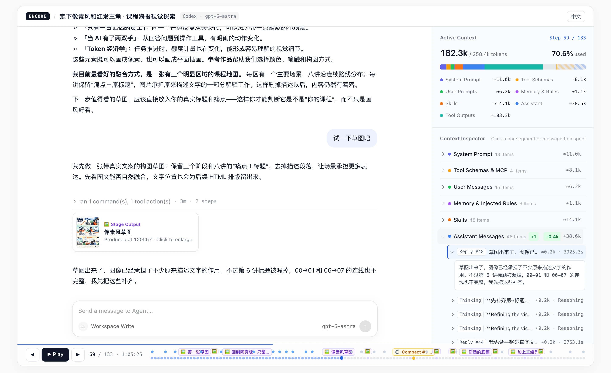

<p align="center">
  
</p>

<p align="center">
  <a href="https://encore.niracler.com"><strong>Live Stage (encore.niracler.com) ↗</strong></a> ·
  <a href="https://www.npmjs.com/package/@niracler/encore"><strong>npm ↗</strong></a> ·
  <a href="./README.md"><strong>English</strong></a> ·
  <a href="./README.zh-CN.md">简体中文</a>
</p>

**Encore** is the [`asciinema`](https://asciinema.org) for AI agent sessions. Instead of blurry screen recordings or flat Markdown dumps, it turns raw transcripts from **Codex**, **Claude Code**, **Claude.ai**, and **WorkBuddy** into an interactive, self-contained web stage.



<table>
  <thead>
    <tr>
      <th width="33%" align="left">Stage Left · The Performance</th>
      <th width="33%" align="left">Stage Right · Context X-Ray</th>
      <th width="33%" align="left">Bottom · Milestone Timeline</th>
    </tr>
  </thead>
  <tbody>
    <tr>
      <td valign="top">Typewriter prompt input, streaming Markdown replies, <code>12×</code> tool call shimmer, sub-agent dispatches, and inline <code>.webp</code> visual outputs.</td>
      <td valign="top">Live <code>200k</code> / <code>1.0M</code> token gauge, 7-color bucket bar, auto-compaction headroom markers, and click-to-inspect raw payloads at any step.</td>
      <td valign="top">Step-by-step scrubber pinned with visual keyframes (<code>🖼</code>), draft docs (<code>📄</code>), context compactions (<code>🗜</code>), and user turns (<code>💬</code>).</td>
    </tr>
  </tbody>
</table>

---

## 01 · Instant Curtain Call (Raw Cut)

These commands use the Encore release tagged `latest` on npm.

```bash
# 1. Interactive picker — scans ~/.codex/sessions, ~/.claude/projects & ~/.workbuddy/projects
#    Use ↑ / ↓ to select and ← / → to flip pages
npx @niracler/encore@latest

# 2. Direct export — auto-detects .jsonl / .jsonl.zst / Claude.ai .json
npx @niracler/encore@latest /path/to/rollout.jsonl -o ./replays/my-session

# 3. Edit ./replays/my-session/session.json and refresh the browser directly,
#    or re-run on the folder to sync <title> and privacy checks:
npx @niracler/encore@latest ./replays/my-session
```

---

## 02 · Director's Cut (Agent Curation)

Raw logs often contain 20+ repetitive screenshots, long opening prompts instead of a clear title, or internal project codenames that regex redaction cannot catch. Link [`skills/encore/SKILL.md`](./skills/encore/SKILL.md) into `.agents/skills/encore` (or `~/.codex/skills/encore` / `~/.claude/skills/encore`) and prompt your agent:

```text
Use the encore skill to export my latest session and curate session.json for publishing.
```

- **Frame Pruning & Naming**: Visually inspects extracted `.webp` images, drops redundant screenshots, and writes concise milestone labels.
- **Title & Playbill Intro**: Writes a sharp `title` and a 1–3 sentence `description` summarizing the problem, pivot, and outcome.
- **Semantic Privacy Redaction**: Replaces internal codenames, colleague names, or private URLs with `(Internal context redacted)`.
- **Time-Window Trimming**: Cuts off-topic turns at the start or end of a session.

---

## 03 · Anywhere on Stage (Zero-Dependency Embed)

Encore separates data (`session.json` + `.webp`), standalone player (`encore-player.js` + `encore-player.css`), and CLI (`encore`). Embed any replay into your blog or docs with three lines:

```html
<link rel="stylesheet" href="./encore-player.css">
<div data-encore-player src="./session.json" data-lang="en"></div>
<script src="./encore-player.js" defer></script>
```

<details>
<summary><strong>CLI Options &amp; <code>session.json</code> Reference</strong></summary>

### CLI Options

```text
Usage:
  encore                              Scan recent Codex, Claude Code & WorkBuddy sessions and pick one interactively
  encore <log.jsonl | dir> [options]  Build a standalone replay directory from a log or re-render an edited session.json
  encore play <dir> [--port 4180]     Start local preview server for an existing replay directory

Options:
  -o, --out <dir>          Output directory (default: ./replays/<session-slug>)
  -l, --lang <zh|en|auto>  Player UI language (default: auto; also toggleable in the topbar)
      --title <text>       Override session title
      --desc <text>        Set opening description shown before playback starts
      --from <iso-time>    Start time window filter (e.g. 2026-11-10T09:00)
      --to <iso-time>      End time window filter
      --no-images          Skip extracting embedded images to .webp
      --image-width <px>   Max width for extracted WebP frames (default: 960)
      --clip <chars>       Max chars per tool input/output (default: 1500/2000)
      --conversation <id>  Conversation UUID for multi-chat Claude.ai exports
      --include-memory     Include full cross-session MEMORY_SUMMARY / User CLAUDE.md text
      --list               List recent local sessions without interactive prompt
      --serve              Start local HTTP preview server after building
      --no-serve           Do not start local HTTP preview server
      --no-open            Do not automatically open browser when serving
  -p, --port <number>      Preview server port (default: 4180)
  -v, --version            Show version number
  -h, --help               Show help message
```

### `session.json` Schema

Formal JSON Schema: [`schema/session.schema.json`](./schema/session.schema.json) (`https://encore.niracler.com/schema/session.schema.json`) · TypeScript Definitions: [`src/index.d.ts`](./src/index.d.ts)

```json
{
  "$schema": "https://encore.niracler.com/schema/session.schema.json",
  "tool": "codex",
  "model": "gpt-5.4",
  "title": "Redesigning the 7-Stage Architecture Diagram",
  "description": "Started with a cluttered layout, pivoted to a two-column grid after visual review, and exported the final SVG.",
  "lang": "en",
  "contextWindow": 258400,
  "deliverables": [{ "title": "Final Diagram", "href": "./final-diagram.webp", "meta": "SVG / WebP · 1920×1080" }],
  "frames": [{ "time": "2026-11-17T10:04:12.000Z", "img": "a1b2c3d4e5f6.webp", "who": "ai", "label": "Draft 1", "w": 960, "h": 540 }],
  "items": [
    { "type": "user", "text": "...", "time": "..." },
    { "type": "tool", "name": "exec_command", "summary": "...", "stats": { "command": 1 }, "time": "..." },
    { "type": "compact", "seq": 1, "trigger": "auto", "preTokens": 210000, "postTokens": 42000, "time": "..." },
    { "type": "assistant", "text": "...", "time": "..." }
  ]
}
```

</details>

## License

[MIT](./LICENSE)
