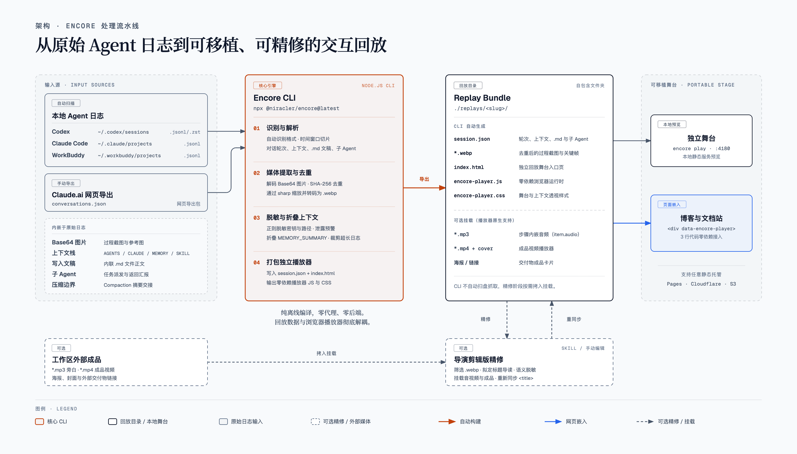

<p align="center">
  
</p>

<p align="center">
  <a href="https://encore.niracler.com"><strong>在线演示 (encore.niracler.com) ↗</strong></a> ·
  <a href="https://www.npmjs.com/package/@niracler/encore"><strong>npm ↗</strong></a> ·
  <a href="./README.md">English</a> ·
  <a href="./README.zh-CN.md"><strong>简体中文</strong></a>
</p>

<p align="center">
  <a href="https://www.npmjs.com/package/@niracler/encore"></a>
  <a href="https://github.com/niracler/encore/actions/workflows/ci.yml"></a>
  = 20.10">
  <a href="./LICENSE"></a>
</p>

**Encore** 是面向 AI Agent 会话的 [`asciinema`](https://asciinema.org)。它把 **Codex**、**Claude Code**、**Claude.ai** 和 **WorkBuddy** 的原始日志离线编译成自包含的交互网页——观众可以沿着时间轴回看对话、工具调用、子 Agent 协作与过程截图，同时在右侧实时观察上下文窗口的增长和压缩。


- **对话与产物区（左侧）**：流式回复、可展开的工具调用批次、子 Agent 汇报、内联 `.md` 文稿以及提取出的 `.webp` 过程截图。
- **上下文透视（右侧）**：实时显示 `200k` / `1.0M` Token 水位与 7 类上下文占比、自动压缩（Compaction）边界，点击任意色块或消息即可查看当时的原文载荷。
- **里程碑时间轴（底部）**：按步切分的进度条，自动标出过程截图（`🖼`）、中间文稿（`📄`）、上下文压缩（`🗜`）与提问节点（`💬`）。

---

## 在线演示

前往 **[encore.niracler.com](https://encore.niracler.com)** 直接体验 5 个覆盖全部支持 Agent 的真实回放（页面右上角支持一键切换中英文界面）：

| 案例 | Agent | 看点 |
| :--- | :--- | :--- |
| [设计与发布 Encore](https://encore.niracler.com/) | **Codex** | 英文功能总览，完整呈现上下文透视、自动压缩与子 Agent 协作 |
| [大改课程海报：三套视觉提案](https://encore.niracler.com/?demo=poster-redesign) | **Codex** | 7 张 `.webp` 视觉演进过程图，中途触发一次上下文自动压缩 |
| [把新版七阶段图接入课件与站点](https://encore.niracler.com/?demo=work-stages-site) | **Claude Code** | 4 个子 Agent 协同、5 张过程截图，含现场定位并修复页面脚本故障 |
| [嫌太难看，重做「七阶段图」](https://encore.niracler.com/?demo=work-stages-design) | **Claude.ai** | 网页导出包（`conversations.json`），探索 5 套版式方向与 9 张迭代稿 |
| [横纵分析开源工具 x-cmd](https://encore.niracler.com/?demo=xcmd-research) | **WorkBuddy** | 并行派发 4 个子 Agent 检索公开资料并汇总结构化报告 |

---

## 快速开始

需要 **Node.js >= 20.10**。无需全局安装，以下命令会直接运行 npm 上的 `latest` 版本：

```bash
# 1. 交互式选片：自动扫描 ~/.codex/sessions、~/.claude/projects 与 ~/.workbuddy/projects
#    按 ↑ / ↓ 选择会话，← / → 翻页
npx @niracler/encore@latest

# 2. 指定日志导出：自动识别 .jsonl、.jsonl.zst 与 Claude.ai 的 conversations.json
npx @niracler/encore@latest /path/to/rollout.jsonl -o ./replays/my-session

# 3. 手动编辑 ./replays/my-session/session.json 后，对目录重跑命令可同步更新 <title>
#    并重新执行敏感词检测：
npx @niracler/encore@latest ./replays/my-session

# 4. 在本地启动静态预览服务（默认 http://localhost:4180）
npx @niracler/encore@latest play ./replays/my-session
```

不指定 `-o` 时，Encore 会在当前目录下创建 `./replays/<会话短名>/`，自动生成自包含的 `session.json`、去重后的 `*.webp`、`index.html`、`encore-player.js` 和 `encore-player.css`。

---

## 工作原理与架构

<p align="center">
  <picture>
    <source media="(prefers-color-scheme: dark)" srcset="./docs/architecture-zh-dark.webp">
    <source media="(prefers-color-scheme: light)" srcset="./docs/architecture-zh-light.webp">
    
  </picture>
</p>

- **纯离线编译，零后端**：所有解析、转码与脱敏均在本机 Node.js 中完成，不经过代理，也不会上传任何日志。
- **数据与播放器解耦**：`session.json` 和 `.webp` 截图独立于零依赖播放器之外，修改标题、导读或删减截图后刷新浏览器即可生效，无需重新打包代码。
- **外部成品边界清晰**：日志内嵌的 Base64 图片、内联 `.md` 文稿、上下文栈与子 Agent 汇报由 CLI 自动提取；工作区磁盘上额外生成的外部成品（`.mp3` 旁白、`.mp4` 视频、海报、PDF 等）不会被 CLI 自动扫盘抓取，只在精修阶段按需拷入挂载。

---

## 精修成导演剪辑版

CLI 一步导出的原始回放通常会保留几十张微调或报错截图，标题也默认截取自第一条长提问，且正则无法识别项目内部代号。

将 [`skills/encore/SKILL.md`](./skills/encore/SKILL.md) 放入 `.agents/skills/encore`（或 `~/.codex/skills/encore` / `~/.claude/skills/encore`），直接对 Agent 说：

```text
用 encore 技能把我刚才那段对话导出并精修一下。
```

技能会引导 Agent 完成 4 步精修：

- **看图筛片与命名**：逐张检查提取出的 `.webp`，剔除报错图与重复微调图，为关键节点补上清晰的 `label`。
- **提炼标题与开场导读**：在 `session.json` 顶层写好 `title` 和 `description`，让读者在点播放前就能看懂问题背景、转折点和结果。
- **语义级隐私清理**：排查正则抓不到的内部项目代号、同事姓名或内网地址，替换为 `（涉及内部业务细节，已略去）`。
- **时间窗口切片**：通过 `--from` / `--to` 或直接编辑 `items[]`，掐掉会话首尾顺手聊的无关话题。

---

## 嵌入博客或文档站

将生成的回放目录直接部署到 GitHub Pages、Cloudflare Pages、Vercel 或对象存储，或在任意网页里写入 3 行代码即可挂载：

```html
<link rel="stylesheet" href="./encore-player.css">
<div data-encore-player src="./session.json" data-lang="zh"></div>
<script src="./encore-player.js" defer></script>
```

省略 `data-lang` 时，播放器会自动跟随 `session.json` 中的语言设置。

<details>
<summary><strong>CLI 参数与 <code>session.json</code> 结构速查</strong></summary>

### CLI 参数

```text
用法：
  encore                              扫描本机最近的 Codex、Claude Code 与 WorkBuddy 会话，上下键选择导出
  encore <log.jsonl | dir> [options]  从原始日志一步生成回放目录，或对已修改的目录重新同步
  encore play <dir> [--port 4180]     启动本地预览服务

常用参数：
  -o, --out <dir>          输出目录（默认：./replays/<会话短名>）
  -l, --lang <zh|en|auto>  界面语言（默认：auto，网页右上角也可一键切换）
      --title <text>       自定义回放标题
      --desc <text>        自定义开场导读说明
      --from <iso-time>    起始时间切片（如 2026-11-10T09:00）
      --to <iso-time>      结束时间切片
      --no-images          不提取内嵌图片
      --image-width <px>   提取的 WebP 最大宽度（默认：960）
      --clip <chars>       单条工具输入/输出最大保留字符数（默认：1500/2000）
      --conversation <id>  Claude.ai 多会话导出包中指定会话 UUID
      --include-memory     保留完整的跨会话 MEMORY_SUMMARY / 用户级 CLAUDE.md 原文（默认自动折叠脱敏）
      --list               仅列出本机最近会话，不进入交互菜单
      --serve              生成后启动本地预览服务
      --no-serve           生成文件后直接退出，不启动本地预览服务
      --no-open            启动预览服务时不自动打开浏览器
  -p, --port <number>      本地预览端口（默认：4180）
  -v, --version            显示版本号
```

### `session.json` 核心字段

JSON Schema 规范：[`schema/session.schema.json`](./schema/session.schema.json)（`https://encore.niracler.com/schema/session.schema.json`）· TypeScript 类型声明：[`src/index.d.ts`](./src/index.d.ts)

```json
{
  "$schema": "https://encore.niracler.com/schema/session.schema.json",
  "tool": "codex",
  "model": "gpt-5.4",
  "title": "定下像素风和红发主角·课程海报视觉探索",
  "description": "从信息过载的第一版草图出发，确立三阶段路线图，最终定版像素风课程海报。",
  "lang": "zh",
  "contextWindow": 258400,
  "deliverables": [{ "title": "定版课程海报", "href": "./final-poster.webp", "meta": "WebP · 1920×1080" }],
  "frames": [{ "time": "2026-11-17T10:04:12.000Z", "img": "a1b2c3d4e5f6.webp", "who": "ai", "label": "像素风草图", "w": 960, "h": 540 }],
  "items": [
    { "type": "user", "text": "...", "time": "..." },
    { "type": "tool", "name": "exec_command", "summary": "...", "stats": { "command": 1 }, "time": "..." },
    { "type": "compact", "seq": 1, "trigger": "auto", "preTokens": 210000, "postTokens": 42000, "time": "..." },
    { "type": "assistant", "text": "...", "time": "..." }
  ]
}
```

</details>

---

## 常见问题

**日志会上传到云端吗？隐私和密钥怎么处理？**
不会。Encore 是纯本地离线工具，不经过任何后端。导出时会自动脱敏常见 API 密钥、私钥、JWT、数据库连接串、邮箱、内网 IP 与本机用户路径（替换为 `~`），默认折叠跨会话的 `MEMORY_SUMMARY` 与用户级 `CLAUDE.md`，并对疑似内网域名和 URL 令牌参数打印预警。但正则无法识别内部项目代号、同事姓名、业务数据，也无法识别截图画面里的敏感内容；公开发布前请务必复核 `session.json` 和留下的 `.webp` 图片。

**文件会生成在哪里？删掉原始日志或原工作区文件会影响回放吗？**
默认会在当前工作目录下创建 `./replays/<会话短名>/`。所有已写入原始日志的内容（对话、上下文、内联 `.md` 文稿以及解码出的 `.webp` 过程图）都会固化在这个文件夹里，导出后再删除原始 `.jsonl` 日志不会影响回放。但日志之外、仅保存在工作区磁盘上的外部成品（例如命令生成的 `.mp3` 旁白、`.mp4` 视频、海报或 PDF）不会被 CLI 自动拷贝；如果尚未拷进回放目录就删除原文件，回放里将无法找回。将其复制到回放目录并在 `session.json` 使用相对路径引用后，整个文件夹就完全自包含。

**为什么直接双击 `index.html`（`file://` 协议）无法播放？**
浏览器播放器通过 `fetch('./session.json')` 加载数据，而浏览器的同源安全策略会拦截 `file://` 下的请求。本地查看请运行 `npx @niracler/encore@latest play ./replays/<会话短名>`；上传到任意静态托管服务后即可直接访问。

**为什么有些截图、音频或成品视频没有自动出现在回放里？**
Encore 只能提取实际以 Base64 形式进入过模型对话或工具返回载荷的图片。由终端脚本直接写到磁盘、未回传给模型查看的媒体文件，以及 Claude.ai 网页导出的 `conversations.json`（官方导出包本身不包含上传图片和 Artifact 渲染图），日志里并不存在对应的二进制数据。播放器原生支持步骤音频（`item.audio`）、`.mp4` 视频与交付物卡片，可在精修阶段拷入目录并登记到 `session.json`。

**右侧上下文面板的 Token 数值是实际账单数字吗？**
当原始日志包含真实 Token 统计（含压缩前后的 `preTokens` / `postTokens`）时，播放器会直接展示记录值；对于缺少步级统计的日志或 7 类分桶拆分，播放器会按内容长度做透明估算，用来观察上下文构成与膨胀趋势，不替代服务商账单。

**导出的原始回放太长或截图太多，怎么精简？**
可以在导出时用 `--from` / `--to` 按时间窗口截取片段，也可以直接编辑 `session.json` 中的 `frames[]`、`items[]`、`title` 与 `description`，再对目录运行 `npx @niracler/encore@latest ./replays/<会话短名>` 同步 `<title>` 并清理已删截图的引用。对已有目录重同步不会覆盖你的手工修改和已挂载媒体；注意若重新从原始 `.jsonl` 导出到同一目录，则会刷新目录内生成的 `.webp` 文件。

---

## 参与贡献与开源协议

项目架构说明与开发命令见 [`AGENTS.md`](./AGENTS.md)。提交改动前请运行 `pnpm test` 验证解析器、脱敏规则与播放器产物一致性；如需新增其他 AI Agent 日志格式支持，欢迎提交 Issue。

[MIT](./LICENSE)
