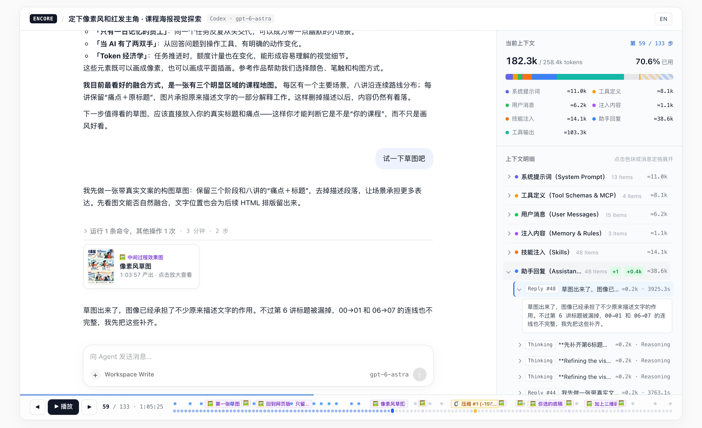

# Encore

**Bring your AI agent sessions back on stage.**
*把 AI Agent 的工作现场搬回舞台再演一场 —— AI Agent 时代的 [`asciinema`](https://asciinema.org)（支持 `Codex`、`Claude Code`、`Claude.ai`、`WorkBuddy`）。*

[English](./README.md) · [简体中文](./README.zh-CN.md)



---

## 它是干什么的？

把 AI 编程或设计过程录成视频又糊又大，而导出成普通 Markdown 聊天记录又会丢掉 Agent 工作流里最精彩的部分：**每一轮上下文窗口（Context Window）里到底塞了什么、调用了哪些工具与子代理、中间视觉稿是怎么一版版演进出来的，以及什么时候触发了上下文压缩（Compaction）。**

**Encore** 将 **OpenAI Codex**、**Claude Code**、**Claude.ai** 和 **WorkBuddy** 的原始会话日志一键转换为可交互的独立网页剧场：

| 舞台区域 | 还原内容 |
| :--- | :--- |
| **左屏 · 对话流与作品演进** | 底部输入框打字上屏、Agent 回复呼吸感流式输出、工具调用流光快切（`1.0×` / `12×` / `0.8×`）、子任务派发与报告弹窗、内嵌 `.webp` 过程效果图、Markdown 中间草稿与音视频交付物。 |
| **右屏 · Context 实时透视面板** | 实时显示上下文窗口水位（`200k` / `1.0M`）、7 色分段进度条（系统提示词、工具定义、用户消息、注入规则、技能、助手回复、工具输出）、自动压缩警戒线，点击任意消息或色块即可定格查看当时的原文载荷。 |
| **底部 · 关键帧章节时间轴** | 按步骤切分的时间轴，自动钉出过程效果图（`🖼`）、中间文稿（`📄`）、上下文压缩（`🗜`）与提问轮次（`💬`）。 |

---

## 三层解耦架构（致敬 `asciinema`）

1. **标准数据格式（`session.json` + `.webp`）**：全量自包含、可直接手改的 JSON 文件（类比 `asciinema` 的 `.cast`），内含标题（`title`）、开场导读（`description`）、最终交付物（`deliverables`）、过程图片关键帧（`frames`）与对话记录（`items`）。
2. **独立播放器（`encore-player.js` + `encore-player.css`）**：零外部依赖的纯前端组件。生成的 `index.html` 极其干净，要在个人博客或文档站嵌入回放，只需一行标签：
   ```html
   <link rel="stylesheet" href="./encore-player.css">
   <div data-encore-player src="./session.json" data-lang="zh"></div>
   <script src="./encore-player.js" defer></script>
   ```
3. **CLI 转换与预览工具（`encore`）**：自动识别日志来源、默认导出 `.webp` 图片、自动脱敏本机路径与密钥（非阻塞告警）、生成静态目录并启动本地预览服务。

---

## 30 秒上手（生肉直出）

### 1. 免找文件：直接扫描本机最近对话

在终端直接运行 `npx @niracler/encore`（不带参数），工具会自动扫描 `~/.codex/sessions`、`~/.claude/projects` 和 `~/.workbuddy/projects` 下最近的对话，显示时间与首句提问，按 `↑` / `↓` 挑一条回车即可导出并打开预览：

```bash
npx @niracler/encore
```

### 2. 指定日志文件一步直出

无需手动指定是哪家工具的日志，`encore` 会自动识别文件内容：

```bash
npx @niracler/encore /path/to/rollout.jsonl -o ./replays/my-session
```

### 3. 改 `session.json` 实时生效

由于 `index.html` 动态读取同目录的 `./session.json`，**你在编辑器里修改 `session.json` 的标题、开场导读或删减图片后，直接刷新浏览器就能看到最新效果，无需重新编译。**

如果需要同步更新 `index.html` 的 `<title>` 标签或重新运行隐私脱敏检查，对目录再跑一次命令即可：

```bash
npx @niracler/encore ./replays/my-session
```

---

## Agent 精修工作流（熟肉策展）

脚本一步直出的「生肉」回放里，往往夹杂着二三十张重复微调或报错的截图，标题也只是第一句长提问。

仓库内置了配套的精修 Skill：[`skills/encore/SKILL.md`](./skills/encore/SKILL.md)。将它放入 `.agents/skills/encore`（或全局 `~/.codex/skills/encore` / `~/.claude/skills/encore`）后，直接对 Agent 说：

> 「用 `encore` 技能把我刚才那段对话导出并精修一下。」

Agent 会自动完成 4 件事：
1. **逐张看图筛废片与起名**：用多模态看图检查导出目录里的 `.webp`，删掉报错图与重复图，只留关键演进节点，并补写清晰的 `label`（如 `"第一张草图：信息过载"`、`"终稿：定版海报"`）。
2. **提炼短标题与故事导读**：去掉空洞套话，在 `session.json` 顶层写出直奔主题的 `title` 与几十宇的 `description` 开场脉络。
3. **语义级隐私与噪音清理**：识别正则抓不到的业务代号、同事姓名或内部地址，替换为 `（涉及内部业务细节，已略去）`。
4. **掐头去尾（时间切片）**：切掉会话首尾顺手聊的无关话题，只保留完整讲好一件事的片段。

---

## `session.json` 字段速查与 CLI 参数

- `title`：页面顶部标题与浏览器标签名（自动取日志标题或首句提问摘要，可直接手改）。
- `description`：点击播放前在空白舞台中央展示的开场导读。
- `lang`：界面默认语言（`"zh"` 或 `"en"`，也可点击网页右上角按钮随时切换中英文）。
- `frames`：过程图片数组 `[{ time, img, who, label, w, h }]`，删掉不需要的项即可从时间轴和对话流中移除该图。
- `deliverables`：会话结束时展示的最终成果列表 `[{ title, href, meta, cover }]`。

```text
用法：
  encore                              扫描本机最近的 Codex、Claude Code 与 WorkBuddy 会话，上下键选择导出
  encore <log.jsonl | dir> [options]  从原始日志一步生成回放目录，或对已修改的目录重新同步
  encore play <dir> [--port 4180]     启动本地预览服务

常用参数：
  -o, --out <dir>          输出目录（默认：./replays/<会话短名>）
  -l, --lang <zh|en|auto>  界面语言（默认：auto，网页右上角也可一键切换）
      --title <text>       自定义回放标题
      --desc <text>        自定义开场导读说明
      --from <iso-time>    起始时间切片（如 2026-11-10T09:00）
      --to <iso-time>      结束时间切片
      --no-images          不提取内嵌图片
      --include-memory     保留完整的跨会话 MEMORY_SUMMARY / 用户级 CLAUDE.md 原文（默认自动折叠脱敏）
      --list               仅列出本机最近会话，不进入交互菜单
      --no-serve           生成文件后直接退出，不启动本地预览服务
  -v, --version            显示版本号
```

## 开源协议

[MIT](./LICENSE)
